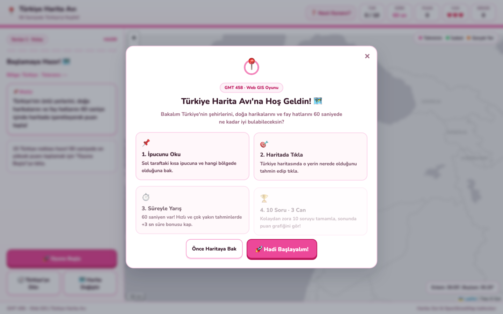
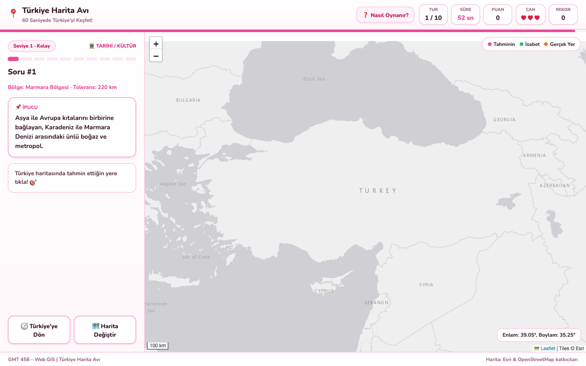

# Türkiye Harita Avı (Turkey Map Hunt) — GMT 458 GeoGame

> **Play the Live Game (GitHub Pages):** [https://begum-miray.github.io/GEOGAME/](https://begum-miray.github.io/GEOGAME/)
>
> **GitHub Repository:** [https://github.com/begum-miray/GEOGAME](https://github.com/begum-miray/GEOGAME)

---

## 1. About the Game & Functional Requirements

For GMT 458 – Web GIS Assignment 2, I designed and built **Türkiye Harita Avı** (*Turkey Map Hunt*), a fun, interactive, Turkey-based GeoGame built with HTML, CSS, and vanilla JavaScript. The interface and clues are in Turkish so anyone can jump in and play right away, while the source code and documentation are in English.

The idea is simple and fun: when the page opens, an animated welcome guide introduces the rules. Once you start, you have **60 seconds** to find 10 famous Turkish landmarks, natural wonders, and active fault/volcanic zones on a clean, label-free **Turkey map**. After every click, the game calculates how many kilometers away you clicked using the **Haversine formula**, animates radar pulse rings and a dashed distance line, celebrates hits with confetti and a floating score toast, and teaches a short fact about that location.

### Functional Requirements
1. **Turkey-Focused Interactive Map:** Render a responsive Leaflet map centered and bounded on Turkey (`[39.05, 35.25]`, zoom `6`) using a clean white label-free basemap (Esri World Light Gray Base), with options to switch to Esri Physical Relief or OpenStreetMap and reset back to Turkey anytime.
2. **Animated Welcome & How-to-Play Screen:** Greet the player on load with a bouncing map-pin animation, staggered rule cards (*Nasıl Oynanır?*), and a header Help button to reopen the guide anytime.
3. **Open Turkey GeoJSON Dataset:** Load 15 curated Turkish locations asynchronously from `data/missions.geojson` (RFC 7946 `FeatureCollection`) covering all 7 regions of Turkey (cultural landmarks, natural wonders, and seismic/volcanic zones).
4. **Progressive Difficulty & Haversine Scoring:** Play 10 rounds across 3 levels (Easy → Medium → Hard) with shrinking tolerance radii (`220 km → 140 km → 90 km`), scoring each guess based on Haversine distance, speed, and consecutive hit streaks.
5. **Playful Game Animations & Tactile UI:** Include 3D pushable arcade-style buttons, radar pulse rings, animated dashed distance lines, floating score toasts, confetti bursts on accurate hits, and panel shake animations on misses.
6. **Temporal Component & Persistence:** Run a 60-second countdown timer with a live progress bar, `+3s` precision time bonuses, an urgent final-10-second warning, and `localStorage` high-score saving.
7. **Post-Game Spatial Analytics (Bonus):** Display an interactive **Chart.js** dual-axis debrief chart at the end of the game comparing each round's error distance (km) and points earned.

---

## 2. Frontend Layout Sketch & Live Screenshots

### Initial Frontend Layout Sketch
Before coding the interface, I sketched the main layout with a top HUD bar, temporal progress strip, left clue sidebar, and interactive Leaflet map canvas:


### Live Game Screenshots

**Animated Welcome & "Nasıl Oynanır?" Screen:**



**Active Gameplay on the Turkey Map (Soft Pastel-Pink & White UI):**



---

## 3. Game Progression, Rules & Temporal Component

### Difficulty Levels & Number of Tasks
Each game selects and shuffles **10 rounds** from the 15-feature Turkey GeoJSON dataset, getting tighter as you advance:

| Level | Rounds | Example Locations in Turkey | Allowed Tolerance |
| :--- | :---: | :--- | :---: |
| **Seviye 1 · Kolay (Easy)** | 4 | Anıtkabir, İstanbul Boğazı, Kapadokya, Efes, Antalya | **220 km** |
| **Seviye 2 · Orta (Medium)** | 3 | Kuzey Anadolu Fayı (İzmit), Pamukkale, Sümela, Erciyes, Van Gölü | **140 km** |
| **Seviye 3 · Zor (Hard)** | 3 | Göbeklitepe, Ağrı Dağı, Nemrut Dağı, Doğu Anadolu Fayı, Salda Gölü | **90 km** |

A 10-segment progress bar at the top of the left panel shows your live progress across all 10 questions (blue = active, green = hit, orange = miss).

### Number of Lives
Players start with **3 lives (`♥♥♥`)**. Clicking outside the target's allowed tolerance radius removes 1 life and resets the hit streak. Losing all 3 lives ends the round and opens the Chart.js summary.

### Scoring & High-Score Mechanism
When your click lands inside the target's tolerance circle (`distanceKm <= maxToleranceKm`), you earn:
- **Proximity Score (up to 1,000 pts):** Closer clicks to the true coordinate earn more points.
- **Streak Bonus:** Consecutive hits earn `+100 × (streak - 1)` extra points and show a `🔥 2x Seri` badge.
- **Speed Bonus:** Answering in `≤ 5s` adds `+150 pts`, and `≤ 9s` adds `+75 pts`.
- **High Score (`Rekor`):** Saved in `window.localStorage` (`geogame_quake_radar_highscore`) so your personal record stays saved across refreshes.

### Temporal Component & Gameplay Impact
- Every session runs on a **60-second** timer (`js/timer.js`), displayed both in the top HUD (`Süre`) and as a shrinking bar across the screen.
- After you click, the timer **pauses** while you look at the distance line and read the short geographic fact, then **resumes** as soon as you click *Sonraki Soru* (or press `Enter` / `Space`).
- **Precision Time Bonus (`+3 sn`):** Clicking within the innermost **35%** of the target's tolerance circle awards `+3` extra seconds (up to 60s).
- In the last **10 seconds**, the timer turns red and pulses. When time hits `0 sn`, `endByTimeout()` finishes the game and opens the analytics modal.

---

## 4. JavaScript Libraries & Open Datasets

### Libraries Used
- **Leaflet.js (`1.9.4`):** Powers the interactive Turkey map, basemap switching, metric scale control, custom animated `L.divIcon` markers, `L.circle` tolerance zones, `L.polyline` distance vectors, tooltips, and `flyToBounds` transitions.
- **Chart.js (`4.4.3`) *(Bonus Library)*:** Renders the post-game dual-axis bar/line chart in `js/analytics.js` comparing spatial error distance (km) against round score (pts) with interactive tooltips.

### Open Datasets & Basemaps
- **`data/missions.geojson`:** RFC 7946 `FeatureCollection` containing 15 real Turkish `[longitude, latitude]` targets compiled from open geographic sources (**AFAD / USGS**, **UNESCO World Heritage Centre**, and **Natural Earth**).
- **Basemaps:** Uses API-key-free **Esri World Light Gray Base** (clean white, label-free) by default, with **Esri World Physical Map** and **OpenStreetMap** available via the *Harita Değiştir* button (plus automatic `tileerror` fallback).

---

## 5. Implementation Highlights

### Three Implemented Event Handlers
1. **Map `mousemove` Handler (`js/main.js`):** Tracks pointer movement across Turkey and updates `#coord-readout` with live latitude and longitude.
2. **Map `click` Handler (`js/main.js`):** Submits the clicked coordinate, pauses the timer, runs `gameEngine.evaluateGuess()`, draws animated radar rings and the dashed distance line, triggers confetti/toast animations, and updates the HUD.
3. **UI `click` & `keydown` Handlers (`js/main.js`):** Handles all 3D action buttons (`#btn-start`, `#btn-next`, `#btn-help`, `#btn-analytics`, `#btn-recenter`, `#btn-basemap`), modal dismissal, and keyboard shortcuts (`Enter`/`Space` for next question, `Escape` to close modals).

### How I Benefited from Closures
I organized the JavaScript into four factory-function modules that use **closures** to protect internal state instead of using global variables:
- **`createGameEngine()` (`js/game.js`):** Keeps `deck`, `currentIndex`, `score`, `highScore`, `lives`, `streak`, `phase`, and `roundResults` private.
- **`createMissionTimer()` (`js/timer.js`):** Keeps `remainingSeconds`, `intervalId`, and `roundStartedAt` private for clean pause/resume and interval cleanup.
- **`createMapController()` (`js/map.js`):** Keeps the Leaflet `map`, `tileLayer`, `activeIndex`, and `roundLayer` encapsulated.
- **`createAnalyticsController()` (`js/analytics.js`):** Keeps `chartInstance` private so old Chart.js charts are destroyed cleanly before re-rendering.

### How I Interacted with the DOM
- **Dynamic HUD & Progress Stepper:** Updates `#hud-round`, `#hud-timer`, `#hud-score`, `#hud-lives`, `#hud-highscore`, `#timer-progress-fill` width, and generates the 10-dot `#round-stepper` using `document.createElement("span")`.
- **In-Game Animations & Confetti:** Dynamically spawns and cleans up animated `.confetti-piece` elements inside `#confetti-layer`, shows floating `#map-toast` messages, updates `#feedback-box`, and triggers CSS keyframe animations (`score-pop`, `panel-shake`).
- **Modals & Chart Canvas:** Manages `#welcome-modal` and `#analytics-modal` visibility/`aria-hidden` states, updates KPI cards, and renders Chart.js onto `<canvas id="performance-chart">`.

---

## 6. Project Structure

```text
GEOGAME/
├── index.html                        # Main HTML5 entry point (GitHub Pages)
├── css/
│   └── style.css                     # Pure white playful UI, 3D buttons & animations
├── js/
│   ├── data.js                       # Async GeoJSON loader & level-based shuffler
│   ├── game.js                       # Closure-based game engine, Haversine math & localStorage
│   ├── timer.js                      # Closure-based 60s timer & response-time tracker
│   ├── map.js                        # Turkey-centered Leaflet controller & radar overlays
│   ├── analytics.js                  # Chart.js post-game spatial accuracy modal
│   └── main.js                       # DOM updates, confetti/toast animations & event handlers
├── data/
│   └── missions.geojson              # 15 Turkish cultural, natural & seismic GeoJSON points
└── assets/
    └── images/
        ├── layout-sketch.svg         # Initial frontend wireframe sketch
        ├── screenshot-welcome.png    # Animated "Nasıl Oynanır?" startup screen
        └── screenshot-gameplay.png   # Active Turkey map gameplay screen
```

---

## 7. What I Learned from AI

Key Web GIS and JavaScript concepts I learned and reinforced:
- **JavaScript Closures for State Encapsulation:** How factory functions keep mutable state private across event callbacks without global variables.
- **GeoJSON vs. Leaflet Coordinate Order:** Why RFC 7946 GeoJSON uses `[longitude, latitude]` while Leaflet expects `[latitude, longitude]`.
- **Haversine Great-Circle Distance:** How spherical trigonometry (`R = 6,371 km`) measures real surface distance in kilometers between two coordinates.
- **Leaflet Map Bounds, Tile Fallbacks & Chart.js Lifecycle:** How to constrain a Leaflet map to Turkey (`maxBounds`), handle tile fallbacks, pair `L.divIcon` with CSS `@keyframes`, and destroy old Chart.js instances cleanly.
- **Clean Git Workflow:** Organizing each feature and improvement into clear, descriptive English commits.
