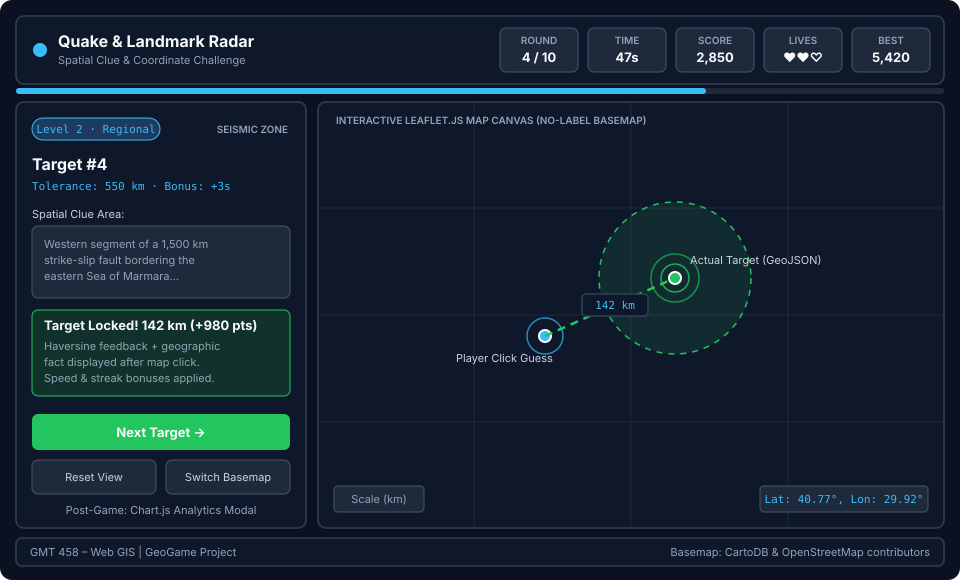

# Deprem & Coğrafya Radarı (Quake & Landmark Radar) — GMT 458 GeoGame

> **Play the Live Game (GitHub Pages):** [https://begum-miray.github.io/GEOGAME/](https://begum-miray.github.io/GEOGAME/)
>
> **GitHub Repository:** [https://github.com/begum-miray/GEOGAME](https://github.com/begum-miray/GEOGAME)

---

## 1. About the Game & Functional Requirements

For GMT 458 – Web GIS Assignment 2, I designed and developed **Deprem & Coğrafya Radarı** (*Quake & Landmark Radar*), an interactive browser-based GeoGame built with HTML, CSS, and vanilla JavaScript. Because the target audience is Turkish-speaking players, the user interface and spatial clues are in Turkish, while the source code, architecture, and documentation are structured in English.

In the game, the player reads tectonic or geographic clues (such as fault lines, subduction zones, volcanic arcs, and iconic world landmarks) and tries to pinpoint the exact location on a label-free world map within **60 seconds**. After each click on the map, the game calculates the great-circle distance in kilometers using the **Haversine formula**, animates the guess and true target with radar pulse rings, and shows an educational geographic fact.

### Functional Requirements
1. **Interactive Label-Free Map:** Display a responsive Leaflet map where players can pan, zoom, reset the view, and switch between label-free basemaps (Esri Light Gray Base, Esri World Physical Map, and OpenStreetMap) while seeing live cursor coordinates (`Lat / Lon`).
2. **Welcome / How-to-Play Screen:** Greet the player on startup with a clear 4-step Turkish guide (*Nasıl Oynanır?*) that can also be reopened anytime from the top header.
3. **Open GeoJSON Mission Data:** Load 15 geographic targets asynchronously from a local RFC 7946 GeoJSON file (`data/missions.geojson`) containing coordinates, clues, difficulty tiers, tolerance radii, and short facts.
4. **Progressive Difficulty & Spatial Evaluation:** Run a 10-round session across 3 difficulty levels with shrinking tolerance radii, evaluating every click with Haversine distance.
5. **Visual & Radar Feedback:** Show animated radar pulse pins, target tolerance circles, dashed distance polylines with km labels, score pop animations, and panel shake animations on misses.
6. **Temporal Component & Persistence:** Enforce a 60-second countdown timer with a live progress bar, speed/precision bonuses, and browser `localStorage` high-score persistence.
7. **Post-Game Spatial Analytics (Bonus):** Visualize round-by-round spatial error (km) and points earned in a Chart.js dual-axis modal when the game finishes.

---

## 2. Frontend Layout Sketch & Live Screenshots

### Initial Frontend Layout Sketch
Before finalizing the interface, I planned the page layout around a top HUD bar, a thin temporal progress strip, a left mission/clue sidebar, and a full-height Leaflet map canvas:



### Live Application Screenshots

**Welcome & "Nasıl Oynanır?" (How to Play) Screen:**


**Active Gameplay Screen (White Minimal Theme & Label-Free Esri Basemap):**


---

## 3. Game Progression, Rules & Temporal Component

### Difficulty Levels & Number of Tasks
Each game consists of **10 rounds** drawn and shuffled per difficulty level from the 15-feature GeoJSON dataset:

| Level | Rounds | Focus | Allowed Tolerance |
| :--- | :---: | :--- | :---: |
| **Seviye 1 · Küresel (Global)** | 4 | Well-known landmarks and major fault zones | **900 km** |
| **Seviye 2 · Bölgesel (Regional)** | 3 | Tectonic boundaries, straits, and mountain belts | **550 km** |
| **Seviye 3 · Hassas (Precision)** | 3 | Subduction trenches, rift valleys, and micro-regions | **300 km** |

A 10-segment progress bar at the top of the left panel tracks the player's progress visually (blue for the active round, green for hits, orange for misses).

### Number of Lives
Players start with **3 lives (`♥♥♥`)**. Clicking outside the current target's tolerance radius deducts 1 life and resets the hit streak. If all 3 lives are lost, the game ends early and opens the analytics summary.

### Scoring & High-Score Mechanism
When a guess falls within the allowed tolerance radius (`distanceKm <= maxToleranceKm`), the score is calculated from three parts:
- **Proximity Base Score (up to 1,000 pts):** Higher points are awarded the closer the clicked point is to the true GeoJSON coordinate.
- **Streak Bonus:** Consecutive hits earn `+100 × (streak - 1)` bonus points and display a live streak badge (`2x Seri`, `3x Seri`, etc.).
- **Speed Bonus:** Answering within 5 seconds adds `+150 pts`, and within 9 seconds adds `+75 pts`.
- **High Score (`Rekor`):** The highest score is saved automatically in `window.localStorage` (`geogame_quake_radar_highscore`) so it persists when the page is refreshed.

### Temporal Component & How It Affects Gameplay
- The entire 10-round session is played under a **60-second** countdown timer (`js/timer.js`), shown both in the header (`Süre`) and as a continuous shrinking bar directly under the header.
- While the player reviews the Haversine distance line and reads the geographic fact between rounds, the timer **pauses** so reading does not penalize the player, and **resumes** when clicking *Sonraki Hedef →* (or pressing `Enter` / `Space`).
- **Precision Time Bonus (`+3 sn`):** If the player's click lands within the innermost **35%** of the target's tolerance radius, `+3` seconds are added back to the clock (up to 60s).
- During the last **10 seconds**, the timer turns red and pulses (`@keyframes timerUrgent`). Reaching `0 sn` ends the game via `endByTimeout()`.

---

## 4. JavaScript Libraries & Open Datasets

### Libraries Used
- **Leaflet.js (`1.9.4`):** Used for the interactive web map, tile basemaps, metric scale bar, custom animated `L.divIcon` radar markers, `L.circle` tolerance zones, `L.polyline` distance vectors, tooltips, and `flyToBounds` camera framing.
- **Chart.js (`4.4.3`) *(Bonus Library)*:** Used in `js/analytics.js` to build a post-game dual-axis combo chart showing each round's spatial error in kilometers (color-coded green/orange bars) alongside the points earned (blue line), with detailed hover tooltips.

### Open Datasets & Basemaps
- **`data/missions.geojson`:** A hand-curated RFC 7946 `FeatureCollection` with 15 real-world `[longitude, latitude]` targets referencing open data from the **USGS Earthquake Hazards Program**, **UNESCO World Heritage Centre**, and **Natural Earth**.
- **Basemaps:** Uses **Esri World Light Gray Base** (clean white, label-free) as the default basemap, **Esri World Physical Map** as an alternate label-free relief view, and **OpenStreetMap** as a standard fallback option. *(During live testing on GitHub Pages, I discovered that CARTO basemap tiles began requiring an API key, so I replaced them with Esri's API-key-free light gray tiles and added an automatic `tileerror` fallback to OpenStreetMap.)*

---

## 5. Implementation Highlights

### Three Implemented Event Handlers
1. **Map `mousemove` Handler (`js/main.js`):** Tracks the user's cursor over the Leaflet map and continuously updates the bottom-right `#coord-readout` badge with the current latitude and longitude.
2. **Map `click` Handler (`js/main.js`):** Captures the clicked coordinates during an active round, pauses the timer, runs `gameEngine.evaluateGuess()` to compute Haversine distance and bonuses, draws the animated radar overlays and distance polyline on the map, and updates the HUD and feedback panel.
3. **UI `click` & `keydown` Handlers (`js/main.js`):** Handles game controls (`#btn-start`, `#btn-next`, `#btn-help`, `#btn-analytics`, `#btn-recenter`, `#btn-basemap`), welcome/analytics modal buttons, and keyboard shortcuts (`Enter`/`Space` to move to the next round, `Escape` to close modals).

### How I Benefited from Closures
Instead of storing game variables globally on `window`, I used factory functions that rely on **closures** to keep internal state private and cleanly separated by module:
- **`createGameEngine()` (`js/game.js`):** Keeps `deck`, `currentIndex`, `score`, `highScore`, `lives`, `streak`, `phase`, and `roundResults` private and exposes only controlled methods (`start`, `evaluateGuess`, `nextRound`, `endByTimeout`, `getState`).
- **`createMissionTimer()` (`js/timer.js`):** Encapsulates `remainingSeconds`, `intervalId`, and `roundStartedAt`, ensuring intervals are cleanly cleared and paused/resumed without leaking timers.
- **`createMapController()` (`js/map.js`):** Encapsulates the Leaflet `map` instance, active `tileLayer`, `activeIndex`, and `roundLayer`.
- **`createAnalyticsController()` (`js/analytics.js`):** Encapsulates `chartInstance` so the previous Chart.js object is always destroyed before drawing a new chart on replay.

### How I Interacted with the DOM
- **Live HUD & Progress Updates:** Dynamically updates text and `aria-label` attributes on `#hud-round`, `#hud-timer`, `#hud-score`, `#hud-lives`, and `#hud-highscore`, adjusts `#timer-progress-fill` width percentage, and builds the 10-dot `#round-stepper` via `document.createElement("span")`.
- **Dynamic Feedback & Animations:** Updates `#feedback-box` with hit/miss styling and geographic facts, toggles classes (`crosshair-active`, `urgent`, `bonus-flash`, `hidden`), and triggers CSS animations (`score-pop`, `panel-shake`) cleanly.
- **Modals & Canvas Rendering:** Controls visibility and accessibility (`aria-hidden`) for both the `#welcome-modal` and `#analytics-modal`, populates the 4 summary KPI cards, and renders the Chart.js graph into `<canvas id="performance-chart">`.

---

## 6. Development Steps & Project Structure

I developed the project incrementally using regular, atomic Git commits:
1. Initialized the repository and created the base HTML/CSS/JS folder structure (`index.html`, `css/`, `js/`, `data/`, `assets/images/`).
2. Integrated Leaflet.js with basemap controls, metric scale, and the main HUD layout.
3. Created the 15-target RFC 7946 GeoJSON dataset (`data/missions.geojson`) and async loader (`js/data.js`).
4. Implemented the core game engine (`js/game.js`), Haversine distance calculation, 3-level progression, and radar pulse/polyline animations.
5. Added the 60-second temporal countdown timer (`js/timer.js`), speed/+3s bonuses, and `localStorage` high-score saving.
6. Added the bonus Chart.js post-game spatial accuracy analytics modal (`js/analytics.js`).
7. Enhanced the UI into a clean pure-white Turkish interface with a "Nasıl Oynanır?" startup guide, 10-round stepper, map legend, and switched basemaps to Esri World Light Gray Base so tiles load reliably on GitHub Pages.

```text
GEOGAME/
├── index.html                        # Main HTML5 entry point (GitHub Pages)
├── css/
│   └── style.css                     # Pure white minimalist theme & keyframe animations
├── js/
│   ├── data.js                       # Async GeoJSON loader & level-based deck shuffler
│   ├── game.js                       # Closure-based game engine, Haversine math & localStorage
│   ├── timer.js                      # Closure-based 60s countdown timer & elapsed time tracker
│   ├── map.js                        # Leaflet controller, Esri/OSM basemaps & radar overlays
│   ├── analytics.js                  # Chart.js post-game spatial debrief modal
│   └── main.js                       # DOM updates, modal controls & event handlers
├── data/
│   └── missions.geojson              # 15 curated seismic & landmark GeoJSON features (Turkish)
└── assets/
    └── images/
        ├── layout-sketch.svg         # Initial frontend wireframe sketch
        ├── screenshot-welcome.png    # Live screenshot of the "Nasıl Oynanır?" screen
        └── screenshot-gameplay.png   # Live screenshot of active gameplay
```

---

## 7. What I Learned from AI

Key Web GIS and JavaScript concepts I reinforced while learning with AI:
- **JavaScript Closures for State Encapsulation:** Understanding how factory functions keep internal state private across event callbacks without polluting the global scope.
- **GeoJSON vs. Leaflet Coordinate Order:** Learning why RFC 7946 GeoJSON stores points as `[longitude, latitude]` while Leaflet expects `[latitude, longitude]`.
- **Haversine Great-Circle Distance:** Understanding how spherical trigonometry (`R = 6,371 km`) calculates accurate surface distances between two geographic coordinates.
- **Leaflet Overlays, Tile Fallbacks & Chart.js Lifecycle:** Learning how to pair Leaflet `L.divIcon` with CSS `@keyframes`, call `map.invalidateSize()` after layout changes, handle tile server fallbacks, and destroy old Chart.js instances before re-rendering.
- **Clean Git Workflow:** Learning how to organize work into small, descriptive English commits that clearly document each stage of the project.
